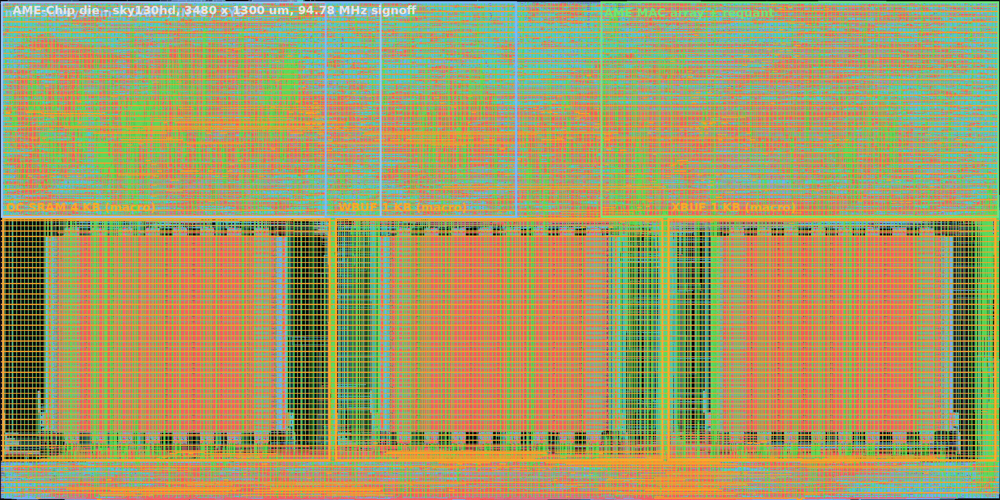
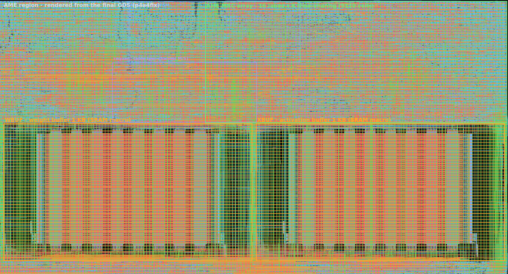
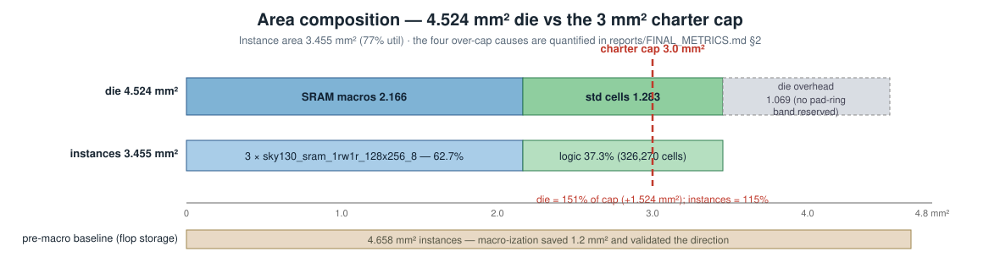
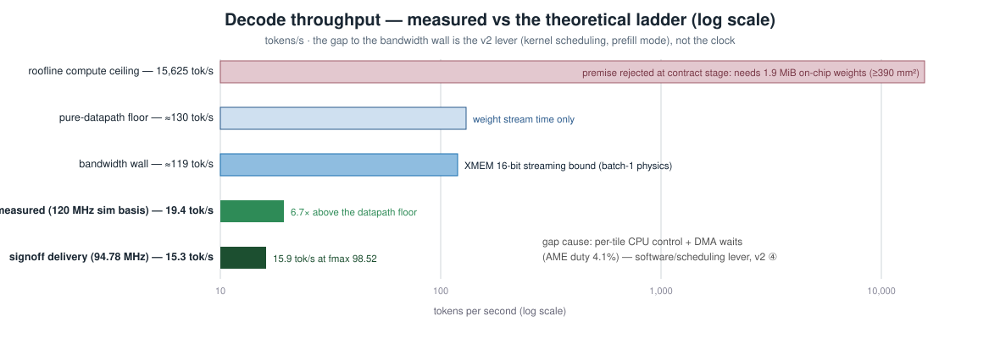
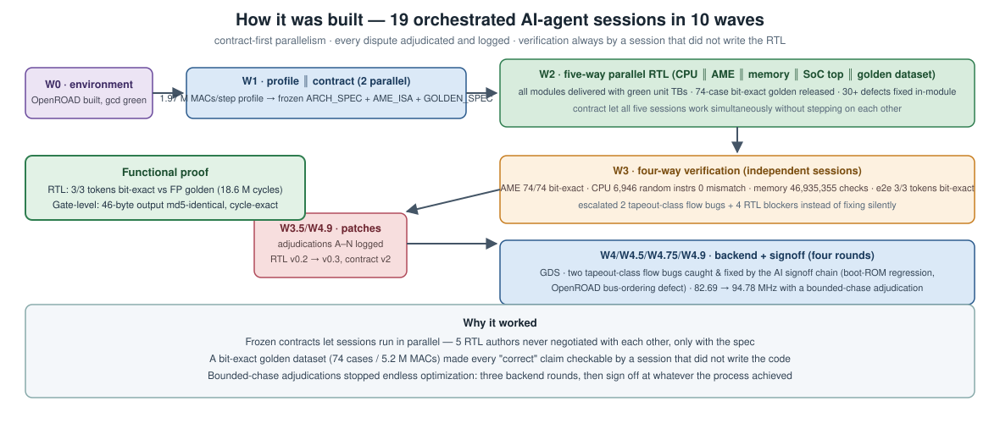

# AME-Chip — An AI-Decode Accelerator Chip, Designed End-to-End by AI Agents

<p align="center">
  
</p>

**The image above is the actual final layout** — three SRAM macros (amber, bottom), the AME MAC-array column (green, right), the RV32IM CPU and memory subsystem (blue, left) — rendered from the tapeout-candidate GDS of a transformer decode-stage accelerator designed end-to-end by orchestrated AI-agent sessions on a 100% open-source toolchain (Yosys / OpenROAD / KLayout / OpenRAM, SkyWater sky130hd).

**Signed off at 94.78 MHz. Gate-level netlist proven byte-identical to RTL. Checklist FAIL=0.**

## Read This In Any Order — click to jump

| # | Question | Section |
|---|---|---|
| 1 | **What is this chip and how does a decode step run on it?** | [The chip](#the-chip) |
| 2 | **What are the numbers?** | [Headline results](#headline-results) |
| 3 | **How do we know it is correct?** | [Proof of correctness](#proof-of-correctness) |
| 4 | **Is it fast and small enough? (honest analysis)** | [Results in context](#results-in-context) |
| 5 | **How did AI agents build it?** | [Built by AI agents](#built-by-ai-agents) |
| 6 | **What is in this repo / how do I reproduce it?** | [Repo & reproduction](#repo--reproduction) |
| 7 | **What is still missing? (v2 roadmap)** | [v2 roadmap](#v2-roadmap) |

---

## The chip

<p align="center">
  
</p>

A 2-layer miniGPT decode step (25 GEMV layers, INT8, 1.97 M MACs) executes fully on chip:

- **AME — INT8 matrix engine** (annotated above): 16 MAC lanes × K-dimension time-sharing, INT32 saturating accumulate, per-channel fixed-point requant with its dedicated table. The two SRAM macros next to it are its private weight/activation buffers (WBUF/XBUF, 1 KB each) — weights stream into them tile by tile.
- **RV32IM core** — in-house 5-stage pipeline; decodes a custom instruction set that drives the AME. Control flow only: every tensor operation happens in the AME.
- **2D DMA engine** — streams weights from off-chip at 235 MB/s (measured; meets the architecture bandwidth budget).
- **KV-cache controller** — append / head-stream read / a custom TRANSPOSE-SLICE datapath for attention P·V.
- **AXI4-Lite fabric** — 4 masters / 9 slaves; plus UART (token output), interrupt controller, and system CSRs.

Deep dive: `docs/PROCESS.md` (method), internal archive for the architecture spec and ISA.

## Headline results

| Metric | Value | Evidence |
|---|---|---|
| Signoff frequency | **94.78 MHz** (10.551 ns, WNS +0.40 / TNS 0 / 0 violations) | [SIGNOFF_REPORT](reports/SIGNOFF_REPORT.md) |
| Measured fmax (capability) | 98.52 MHz (10.150 ns, zero margin) | [SIGNOFF_REPORT](reports/SIGNOFF_REPORT.md) |
| Area | 3.449 mm² instances / 4.524 mm² die (77% util) | [FINAL_METRICS](reports/FINAL_METRICS.md) |
| Power | 241.8 mW; IR drop < 0.5 mV | [FINAL_METRICS](reports/FINAL_METRICS.md) |
| Decode throughput | **15.3 tokens/s**; 15.76 mJ per token | [FINAL_METRICS](reports/FINAL_METRICS.md) |
| Signoff checklist | **PASS 34 / FAIL 0 / NA 7** | [TAPEOUT_CHECKLIST](reports/TAPEOUT_CHECKLIST.md) |

## Proof of correctness

Every "correct" claim traces to one discipline: a **74-case bit-exact golden dataset** (5.2 M MACs, covering extremes, remainders, and the full chain), written as a spec first and independently re-verified.

1. **Unit level** — every module's TB green; the AME passes all 74 golden cases bit-exact across three simulation variants.
2. **CPU level** — 6,946 random instructions differential-tested against an independent ISS: 0 mismatches.
3. **Full chip (RTL)** — a complete decode step (boot → DMA weight fetch → 25 GEMV+requant → KV read/write → token out) matches the golden token sequence: **3/3 tokens bit-exact**.
4. **Gate level** — the same program on the synthesized netlist produces **46 bytes of UART output md5-identical to RTL, with the same cycle count**.
5. **Flow integrity** — SRAM-macro connections verified bit-by-bit (1263/1263, with negative controls); independent STA recheck; pin-level LVS in three layers.

## Results in context





Honest accounting against the charter's two stretch goals: throughput is 16% of the bandwidth-wall prediction — the gap is per-tile CPU control and DMA waits (AME duty 4.1%), a software/scheduling lever, not the clock; the die is 151% of the 3 mm² cap with all four over-cap causes quantified. Both are v2 items and the sprint data is already archived (100 MHz missed by 7 endpoints on one path family).

## Built by AI agents



Nineteen orchestrated AI-agent sessions in 10 waves. A frozen contract set let five RTL sessions run in parallel without negotiating with each other; verification was always executed by a session that did not write the RTL; every dispute went to an adjudication log (A–N) instead of a silent fix. The signoff chain caught two tapeout-class bugs in its own backend — a boot-ROM regression and an OpenROAD `read_verilog` bus-ordering defect that silently reversed every SRAM macro connection. Details: **[docs/PROCESS.md](docs/PROCESS.md)**.

## Repo & reproduction

```
├── rtl/                      ← RTL v0.3 (frozen): cpu/ ame/ mem/ soc/ interfaces/
├── tb/                       ← unit TBs + integration + gate-level signoff TBs
├── syn/amechip/              ← ORFS flow assets: config, SDC, macro wrappers, guards
├── pnr/amechip/results/.../p4a4fix/   ← final GDS / netlist / CDL / SDF / constraints
├── docs/                     ← final report (English) + process + images
├── reports/                  ← metrics ledger, bugs ledger, checklist, signoff report
└── scripts/                  ← assembler, ISS, golden verify, release_check.sh …
```

Final deliverables live in `pnr/amechip/results/sky130hd/amechip/p4a4fix/`: `6_final.gds.gz` (21 MB), `6_final.v` (gate netlist), `6_final.cdl`, `6_final.sdf.gz`, `6_final.sdc`.

Reproduce from RTL: `scripts/release_check.sh --quick` (lint + fast sims + STA, ~35 s) up to `--full` (synthesis → P&R → DRC → gate sims). Tool requirements and setup are in the flow READMEs under `syn/amechip/` and `tb/gate/`.

## v2 roadmap

1. **100 MHz** — 7 endpoints short on one path family; sprint archived.
2. **Area convergence** — die is 151% of the charter cap; four quantified causes.
3. **Multi-corner PVT** — regenerate SRAM macro libs; rerun the scripted flow.
4. **Throughput** — prefill mode, kernel scheduling, 32×32 array option.
5. **Formal equivalence** (hierarchical), full-flatten LVS, injection-class gate regressions.
6. **Upstream report** — OpenSTA `read_verilog` concatenation-ordering defect (found, root-caused, worked around here).
