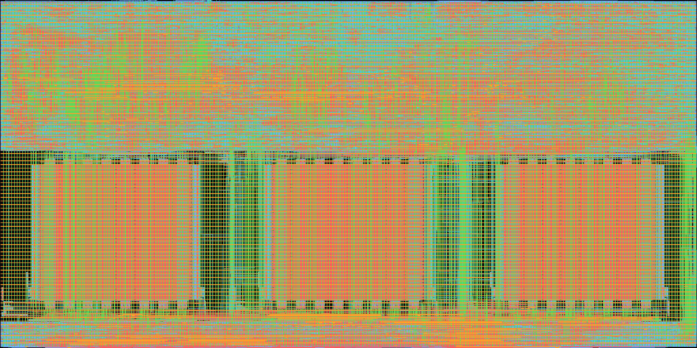
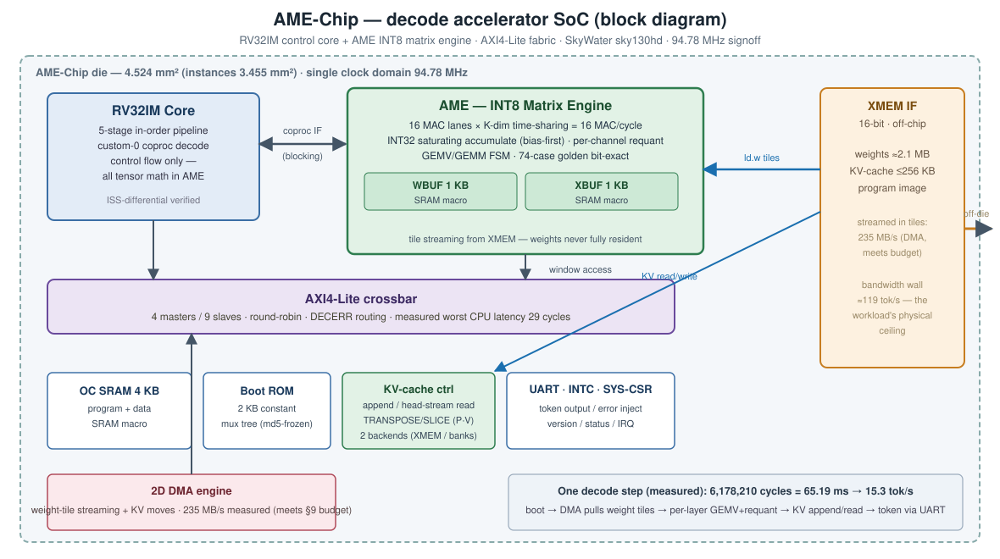

# AME-Chip — An AI-Decode Accelerator Chip, Designed End-to-End by AI Agents

<p align="center">
  
</p>

**The die shot above is real silicon layout** — three SRAM macros (bottom row) and ~326k standard cells, from the final GDS of a transformer decode-stage accelerator taken through RTL → synthesis → place & route → signoff entirely by orchestrated AI-agent sessions on a 100% open-source toolchain (Yosys / OpenROAD / KLayout / OpenRAM, SkyWater sky130hd).

**Final deliverable: a tapeout-candidate GDS, signed off at 94.78 MHz, with the on-chip decode pipeline proven bit-exact from RTL down to the synthesized gates.**

---

## Headline Results

| Metric | Value | Evidence |
|---|---|---|
| Signoff frequency | **94.78 MHz** (10.551 ns, WNS +0.40 / TNS 0 / 0 violations) | [SIGNOFF_REPORT](reports/SIGNOFF_REPORT.md) |
| Measured fmax (capability) | 98.52 MHz (10.150 ns, zero margin) | [SIGNOFF_REPORT](reports/SIGNOFF_REPORT.md) |
| Area | 3.449 mm² instances / 4.524 mm² die (77% util) | [FINAL_METRICS](reports/FINAL_METRICS.md) |
| Power | 241.8 mW; IR drop < 0.5 mV | [FINAL_METRICS](reports/FINAL_METRICS.md) |
| Decode throughput | **15.3 tokens/s**; 15.76 mJ per token | [FINAL_METRICS](reports/FINAL_METRICS.md) |
| Functional proof | 3/3 decode tokens bit-exact RTL↔golden; gate-level output **md5-identical to RTL, cycle-identical** | [SIGNOFF_REPORT](reports/SIGNOFF_REPORT.md) |
| Signoff checklist | **PASS 34 / FAIL 0 / NA 7** | [TAPEOUT_CHECKLIST](reports/TAPEOUT_CHECKLIST.md) |

## What the Chip Is



A 2-layer miniGPT decode step (all 25 GEMV layers, INT8, 1.97 M MACs) runs on-chip: the RV32IM core only orchestrates — every tensor operation goes to the **AME** custom INT8 matrix engine (16 MAC lanes × K-dim time-sharing, INT32 saturating accumulate, per-channel requant). Weights (≈2.1 MB) stream from off-chip through a 2D DMA at 235 MB/s; a dedicated KV-cache controller with a custom TRANSPOSE/SLICE datapath serves attention. The architecture deliberately rejects a wide systolic array: batch-1 decode is bandwidth-bound, and the adjudicated design (ARCH_SPEC §9.2) spends area on streaming, not on idle multipliers.

## Results in Context


Function is fully proven. Against the charter's two stretch goals the report is honest: throughput is 16% of the bandwidth-wall prediction — the gap is per-tile CPU control and DMA waits (AME duty 4.1%), a software/scheduling lever, not the clock; and the die is 151% of the 3 mm² charter cap, with all four over-cap causes quantified. Both are v2 roadmap items with the sprint data already archived (100 MHz missed by 7 endpoints on one path family).

## Repository Layout

```
├── README.md                 ← you are here
├── rtl/                      ← RTL v0.3 (frozen): cpu/ ame/ mem/ soc/ interfaces/ + package
├── tb/                       ← verification: unit TBs per module + integration + gate-level
│   ├── cpu/  ame/  mem/      ← module-level TBs (all green)
│   ├── soc/                  ← SoC smoke + full-chip e2e (3/3 tokens bit-exact)
│   ├── integ/                ← CPU×AME instruction-level co-simulation
│   └── gate/                 ← gate-level signoff TBs, LVS/STA scripts, probes
├── syn/amechip/              ← ORFS flow assets: config, SDC, macro wrappers, guard rails
├── pnr/amechip/results/.../p4a4fix/   ← FINAL DELIVERABLES (see below)
├── docs/                     ← final report (English), process summary, images
├── reports/                  ← FINAL_METRICS / FINAL_BUGS / TAPEOUT_CHECKLIST / SIGNOFF_REPORT
└── scripts/                  ← 30+ tools: assembler, ISS, golden verify, release_check.sh
```

### Final Deliverables — `pnr/amechip/results/sky130hd/amechip/p4a4fix/`

| File | What it is |
|---|---|
| `6_final.gds.gz` (21 MB) | Final layout, DRC-clean, KLayout-verified (gunzip → 158 MB GDS) |
| `6_final.v` | Gate-level netlist (94,426 cells) — gate sims bit-exact vs RTL |
| `6_final.cdl` | Post-layout netlist for LVS (merged with SRAM-macro masters) |
| `6_final.sdf.gz` (5 MB) | Timing annotation (SPEF-backed) |
| `6_final.sdc` | Signoff constraints (10.551 ns clock) |

`scripts/release_check.sh` regenerates everything from RTL: `--quick` (lint + fast sims + STA chain, ~35 s) up to `--full` (synthesis → P&R → DRC → gate sims).

## Signoff Status — Proven vs Carried

**Proven (FAIL=0 on the tapeout checklist):** static timing (setup/hold, independently recomputed), routing DRC = 0, KLayout DRC (macro-external) = 0, IR drop < 0.5 mV, power, gate-level functional equivalence (byte-exact, cycle-exact), SRAM-macro binding verified bit-by-bit (1263/1263, with negative controls), pin-level LVS in three layers.

**Known limitations (documented, none blocking the functional claim):** single-corner (TT) signoff — the SRAM macro lib ships one PVT corner; gate sims use a +XINIT basis — root-caused to X-pessimism from reset-less queue slots, with a discriminating experiment proving silicon-invisibility; formal equivalence stopped at macro black boxes; LVS is pin-level rather than full-flatten. All four are v2 items with defined fixes.

## How It Was Built


Nineteen orchestrated AI-agent sessions in 10 waves. A frozen contract set (`ARCH_SPEC` / `AME_ISA` / `GOLDEN_SPEC`) let five RTL sessions run in parallel without negotiating with each other; a 74-case bit-exact golden dataset made every "correct" claim checkable by a session that did not write the code; and every dispute went to an adjudication log (adjudications A–N) instead of a silent fix. The signoff chain caught two tapeout-class bugs in its own backend — a boot-ROM regression and an OpenROAD `read_verilog` bus-ordering defect that silently reversed every SRAM macro connection — see **[docs/PROCESS.md](docs/PROCESS.md)** for the full method and lesson list.

## Documentation Index

| Document | What it covers |
|---|---|
| [docs/FINAL_REPORT.md](docs/FINAL_REPORT.md) | Final report: executive summary, metrics, attainment analysis, v2 roadmap |
| [docs/PROCESS.md](docs/PROCESS.md) | The agent-driven method, wave history, lessons |
| [reports/FINAL_METRICS.md](reports/FINAL_METRICS.md) | Every signoff number with its source report |
| [reports/FINAL_BUGS.md](reports/FINAL_BUGS.md) | Complete defect ledger — 100+ items, all dispositioned |
| [reports/TAPEOUT_CHECKLIST.md](reports/TAPEOUT_CHECKLIST.md) | The signoff checklist (PASS 34 / FAIL 0 / NA 7) |
| [reports/SIGNOFF_REPORT.md](reports/SIGNOFF_REPORT.md) | Gate-level signoff round: root causes, evidence chains |

Per-session working records (architecture spec, ISA, golden spec, contract patch log) are maintained in the internal archive.

## v2 Roadmap (from measured data, not guesses)

1. **100 MHz** — 7 endpoints short on one path family (`y1_q→p_u_q`); sprint archived.
2. **Area convergence** — die is 151% of the charter cap; four quantified causes.
3. **Multi-corner PVT** — regenerate SRAM macro libs; rerun the scripted flow.
4. **Throughput** — prefill mode, kernel scheduling, 32×32 array option.
5. **Formal equivalence** (hierarchical), full-flatten LVS, injection-class gate regressions.
6. **Upstream report** — OpenSTA `read_verilog` concatenation-ordering defect (found, root-caused, worked around here).
